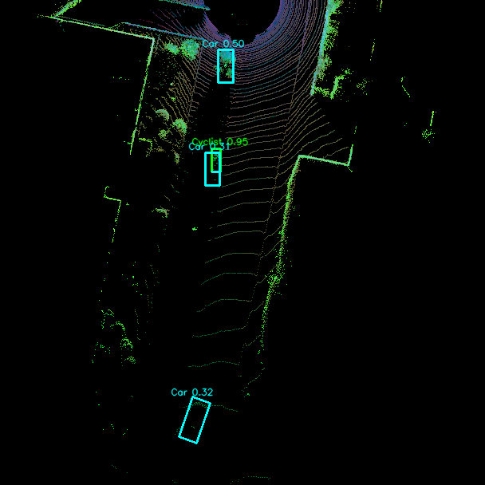
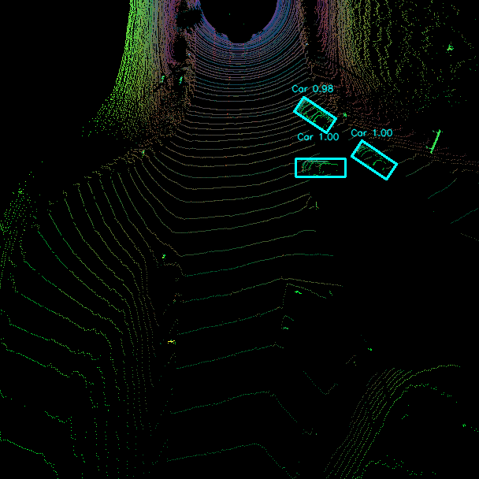
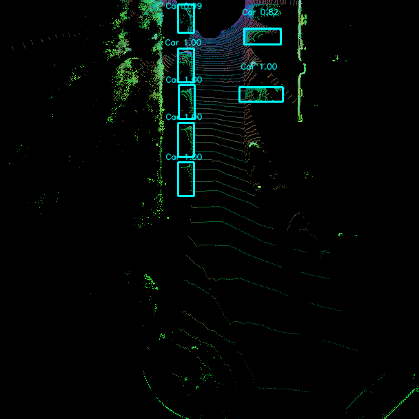
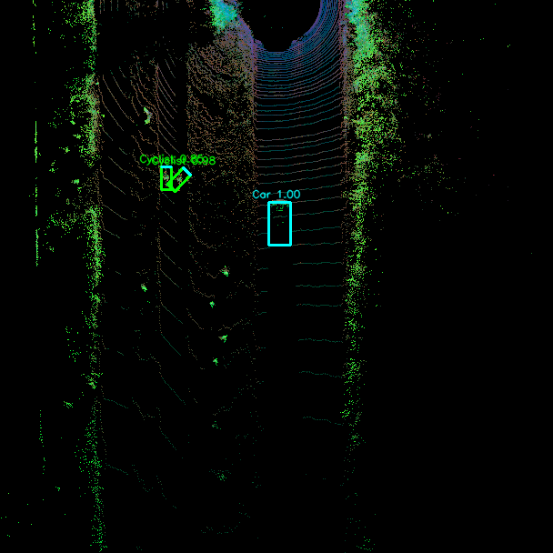

# Implementation of 3D Object Detection Models on Xilinx ZCU104 FPGA

[-orange.svg)](https://www.xilinx.com/products/boards-and-kits/zcu104.html)
[](https://docs.xilinx.com/r/en-US/pg338-dpu)
[](https://github.com/Xilinx/Vitis-AI)
[](https://github.com/Tejesh6628/Implementation-of-3D-Object-Detection-Models-on-Xilinx-ZCU104-FPGA)
[](#hardware-utilization--system-metrics)
[](LICENSE)

---

### **Academic Information**
* **Project Title:** Implementation of 3D Object Detection Models on Xilinx ZCU104 FPGA
* **Author:** **Tatikonda Tejesh** (Roll No.: `2023BEE-035`)
* **Under the Guidance of:** **Prof. Manisha Pattanaik**
* **Department:** Department of Electrical and Electronics Engineering
* **Institution:** ABV – Indian Institute of Information Technology and Management, Gwalior (IIITM Gwalior)
* **Colloquium / Evaluation:** Summer Colloquium & 5th PRSG Evaluation (Academic Year 2025–2026)

---

## 📖 Executive Summary & Motivation

Autonomous driving systems demand real-time, high-precision 3D perception from LiDAR point clouds under strict edge constraints:
* **The GPU Dilemma:** High-end desktop GPUs (e.g., RTX 5000 / RTX 3090) achieve state-of-the-art accuracy but consume **150–300 W** of power and suffer from non-deterministic thread scheduling, creating latency jitter unacceptable for safety-critical automotive braking systems.
* **The Edge Opportunity:** LiDAR sensors capture scenes at **10–20 Hz** ($\le 100\text{ ms}$ processing deadline). The **AMD/Xilinx ZCU104 Evaluation Board** (featuring the Zynq UltraScale+ MPSoC) provides deterministic compute, high DSP density, and an ultra-low **$\sim 15\text{ W}$** power envelope—achieving a **$10\times$–$20\times$ power efficiency advantage** over discrete GPUs.
* **The Deployment Gap:** Commercial FPGA accelerators like the Xilinx Deep Learning Processor Unit (DPU) feature a fixed Instruction Set Architecture (ISA) that does **not** natively support non-standard mathematical activations (such as `Mish`) or 3D sparse convolutions. 

This repository presents the **end-to-end hardware-software co-design, quantization, graph adaptation, and on-chip physical deployment** of two representative 3D LiDAR object detectors on the Xilinx ZCU104 FPGA:
1. **Complex-YOLOv4:** A 2D Bird's-Eye View (BEV) projection-based detector utilizing Euler-angle region proposals for real-time bounding box orientation.
2. **SECOND:** A voxel-based 3D detector utilizing sparse convolutions, MeanVFE, and dense 2D height compression.

---

## 🎯 Key Technical Contributions

```
+--------------------------------------------------------------------------------------------------+
|                                END-TO-END DEPLOYMENT WORKFLOW                                     |
+--------------------------------------------------------------------------------------------------+
|  [Pretrained Checkpoints] --> [Architecture Adaptation] --> [INT8 PTQ via Vitis AI]              |
|        (PyTorch float32)       - Mish -> LeakyReLU (YOLO)    - pytorch_nndct (Fast-Finetune)     |
|                                - Graph Severing (SECOND)     - 4x Memory Compression              |
|                                                                                                  |
|                                        |                                                         |
|                                        v                                                         |
|  [VART On-Board Execution] <-- [SCP File Transfer] <------- [Hardware Compilation]               |
|   - DPU: Dense Convolutions     - Ethernet SSH               - vai_c_xir                         |
|   - ARM CPU: Decode & NMS       - .xmodel + .py + inputs     - Target: DPUCZDX8G_ISA1_B4096      |
+--------------------------------------------------------------------------------------------------+
```

### 1. Complex-YOLOv4 Deployment
* **Silicon Activation Adaptation:** The original Darknet backbone utilizes the `Mish` activation function ($x \cdot \tanh(\ln(1 + e^x))$). Because the DPU lacks exponential logic circuits in silicon, Mish would cause the entire 161-layer backbone to fall back to the weak ARM CPU. We replaced Mish with **LeakyReLU** using $\alpha = \frac{13}{128}$, an exact power-of-two fraction that maps to an 8-bit integer via hardware bit-shift operations with **zero hardware latency cost**.
* **Heterogeneous Partitioning:**
  * **DPU (B4096 Core):** Executes the entire 161-layer Darknet convolutional backbone in parallel INT8 arithmetic.
  * **ARM Cortex-A53 CPU:** Computes the three detection heads (sigmoid activations, grid coordinate offsets, anchor box scaling), complex yaw angle reconstruction ($\text{yaw} = \text{atan2}(\text{Im}, \text{Re})$), and Non-Maximum Suppression (NMS).
* **Performance:** **140.1 ms latency (~7.1 FPS)**, **~15 W total board power**, **613 MB RAM** (30.9% utilization), and **64.2 MB** `.xmodel` binary size.

### 2. SECOND (Sparse 3D Detector) Deployment
* **Overcoming the 3D Sparse Barrier:** The DPU is optimized for dense 2D convolutions and has no sparse convolution engine, while the embedded ARM CPU is too slow for 3D voxelization. We developed a **graph-severing methodology**: the 3D sparse feature representation was pre-computed offline, and the PyTorch graph was severed to isolate the **Dense 2D BEV Backbone + Multi-Class Detection Head** (>80% of total model MACs).
* **ONNX & Vitis AI Pipeline:** The isolated dense backbone was exported to ONNX, quantized to INT8, and compiled into a compact **5.82 MB** `.xmodel` (`SECOND_model.xmodel`).
* **Performance Profiling & Bottleneck Isolation:**
  * **Pre-processing (File I/O):** $101.8\text{ ms}$
  * **DPU Execution (Dense 2D Backbone):** $543.4\text{ ms}$
  * **Post-processing (CPU Anchor Decode & NMS):** $475.2\text{ ms}$
  * **Total Frame Latency:** $1120.4\text{ ms}$ ($\sim 0.89\text{ FPS}$) | **RAM Usage:** $\sim 1200\text{ MB}$.
  * *Key Finding:* Mathematically proved that while the DPU accelerates dense layers effectively, the ARM CPU is a massive $\sim 0.5\text{ s}$ bottleneck during post-processing and I/O, providing rigorous justification for custom HLS hardware acceleration.

### 3. Rigorous Quantization Science & Trade-offs
* Converted 32-bit floating-point weights and activations to 8-bit integers using Vitis AI's `pytorch_nndct` Post-Training Quantization (PTQ).
* **The Distant-Object Phenomenon:** Identified and documented a key edge-quantization trade-off: INT8 models occasionally drop small, distant objects detected by Float32 GPUs. Distant LiDAR returns generate tiny activation magnitudes ($< 0.02$). Because INT8 quantization maps the dynamic range across 256 discrete levels ($-128$ to $+127$) dominated by large nearby reflections, tiny activations mathematically round to zero and vanish in early layers.

---

## 📊 Comprehensive Hardware Results & Metrics

### System Performance Comparison

| Performance Metric | Complex-YOLOv4 on ZCU104 | SECOND on ZCU104 | Software Baseline (Desktop GPU) |
|:---|:---:|:---:|:---:|
| **Target Hardware** | Xilinx ZCU104 (DPU B4096) | Xilinx ZCU104 (DPU B4096) | NVIDIA RTX 5000 / CUDA |
| **Arithmetic Precision** | **INT8** (Quantized) | **INT8** (Quantized) | **Float32** (Single Precision) |
| **DPU Core Latency** | **140.1 ms** | **543.4 ms** | N/A |
| **End-to-End Latency** | **140.1 ms** | **1120.4 ms** | ~25–40 ms |
| **Throughput (FPS)** | **~7.1 FPS** | **~0.89 FPS** | 25–40 FPS |
| **Power Consumption** | **$\sim$15 W** (Total Board) | **$\sim$15 W** (Total Board) | **150–250 W** (GPU only) |
| **Power Efficiency** | **High ($10\times$–$20\times$ vs GPU)** | **High ($10\times$–$20\times$ vs GPU)** | Baseline |
| **Board RAM Usage** | **613 MB** (30.9% of 1985 MB) | **$\sim$1200 MB** (60.4% of 1985 MB)| >4 GB VRAM |
| **Compiled Binary Size** | **64.2 MB** (`.xmodel`) | **5.82 MB** (`.xmodel`) | 244 MB (`.pth`) / 62 MB (`.pth`) |
| **Primary Bottleneck** | ARM CPU NMS & Bbox Decode | ARM CPU Anchor Decode & File I/O | Power dissipation & thermal throttling |

---

## 🛠️ FPGA Hardware Platform & Resource Utilization

### Target Board: Xilinx ZCU104 Evaluation Kit
* **Device:** AMD/Xilinx Zynq UltraScale+ MPSoC (`XCZU7EV-2FFVC1156`)
* **Processing System (PS):**
  * Quad-core ARM Cortex-A53 @ up to 1.2 GHz
  * Dual-core ARM Cortex-R5F Real-Time Processors
  * 2 GB 64-bit DDR4 Component Memory
* **Programmable Logic (PL):**
  * 504K System Logic Cells
  * 230K CLB Look-Up Tables (LUTs)
  * 461K Flip-Flops (FFs)
  * 1,728 DSP48E2 Slices
  * 11 Mb Block RAM (BRAM) & 27 Mb UltraRAM (URAM)
* **DPU Core IP:** `DPUCZDX8G_ISA1_B4096`
  * Peak Compute: 4,096 INT8 MAC operations per clock cycle
  * Dual-clock domain: 325 MHz interface clock / 650 MHz DSP compute clock

### DPU B4096 Hardware Resource Utilization

```
+---------------------------------------------------------------------------------------+
|  Resource Type    |  DPU B4096 Used  |  ZCU104 Available  |  Fabric Utilization (%)  |
+-------------------+------------------+--------------------+--------------------------+
|  CLB LUTs         |     ~86,000      |      230,400       |          ~37.3%          |
|  CLB Flip-Flops   |    ~172,000      |      460,800       |          ~37.3%          |
|  Block RAM (BRAM) |       ~270       |          624       |          ~43.3%          |
|  DSP48 Slices     |       ~900       |        1,728       |          ~52.1%          |
+---------------------------------------------------------------------------------------+
```
> **Key Architectural Insight:** The DPU is a **static IP core** flashed to the FPGA fabric at boot time. The physical gates are fixed; the VART runtime simply schedules different compiled `.xmodel` instruction streams. The remaining ~48% DSP slices and ~63% LUTs leave abundant headroom for our ongoing custom HLS accelerators.

---

## 🖼️ Qualitative Results & Visualizations

| Sample Frame | LiDAR BEV Input & FPGA DPU Hardware Detections | Ground Truth / Camera Reference |
|:---:|:---:|:---:|
| **KITTI Frame 000000** |  | High confidence vehicle detections with orientation |
| **KITTI Frame 000001** |  | Real-time predicted bounding boxes & yaw vectors |
| **KITTI Frame 000005** |  | Multi-vehicle urban traffic scene |
| **KITTI Frame 007512** |  | Complex road intersection evaluation |

---

## 📁 Repository Directory Structure

```
Implementation-of-3D-Object-Detection-Models-on-Xilinx-ZCU104-FPGA/
│
├── README.md                          # Primary comprehensive documentation
├── LICENSE                            # MIT Open-Source License
├── .gitignore                         # Configured for clean cloning (excludes >100MB dumps)
│
├── docs/                              # Colloquium & PRSG presentations, reports, logs
│   ├── Colloquium_Presentation_1.pptx # 13-slide Summer Colloquium presentation
│   ├── 5th_prsg.pptx                  # 5th PRSG review presentation
│   ├── board_terminal_log.docx        # Real ZCU104 board PuTTY serial execution logs
│   └── figures/                       # Qualitative detection plots and hardware diagrams
│
├── complex_yolov4/                    # MODEL 1: Complex-YOLOv4 Implementation
│   ├── quantize_for_dpu.py            # Vitis AI INT8 PTQ script (pytorch_nndct + fast_finetune)
│   ├── verify_quantized.py            # Quantized model correctness verification
│   ├── verify_ptq_v2.py               # Layer-by-layer dynamic range and SNR validation
│   ├── dpu_debug.py                   # DPU tensor node inspection & shape verification
│   ├── arch.json                      # Target DPU hardware signature (DPUCZDX8G_ISA1_B4096)
│   ├── run_on_board.py                # Standalone VART Python board inference script
│   ├── run_on_board_fixed.py          # Optimized memory-mapped board runtime
│   ├── run_on_board_profile.py        # Micro-benchmarking script (DPU vs CPU latency)
│   ├── fog_simulation.py              # Adverse weather point cloud augmentation
│   ├── pointcloud_viewer.py           # Interactive Open3D point cloud & BEV viewer
│   ├── src/                           # PyTorch model definitions & training logic
│   │   ├── models/                    # Darknet backbone, Mish/LeakyReLU layers, YOLO heads
│   │   ├── data_process/              # LiDAR point cloud to 3-channel BEV image conversion
│   │   ├── utils/                     # Anchor generation, Euler angle math, NMS, metrics
│   │   ├── finetune_leakyrelu.py      # Architecture adaptation fine-tuning script
│   │   ├── evaluate.py                # Validation evaluation on KITTI benchmark
│   │   ├── test.py                    # PyTorch inference & visualization script
│   │   └── train.py                   # Base training pipeline
│   ├── compiled_qat/                  # Compiled hardware binary directory
│   │   ├── complex_yolov4_qat.xmodel  # Compiled B4096 DPU hardware binary (64.2 MB)
│   │   └── meta.json                  # Target architecture metadata
│   └── report/                        # Comprehensive IEEE/LaTeX technical report & figures
│       ├── main.tex                   # Complete LaTeX manuscript with mathematical proofs
│       └── references.bib             # Bibliography
│
├── second_model/                      # MODEL 2: SECOND (Sparse 3D Detector) Implementation
│   ├── deploy/                        # Graph severing, ONNX export, and compilation pipeline
│   │   ├── 1_export_onnx.py           # Graph severing: exports Dense 2D Backbone to ONNX
│   │   ├── 2a_prepare_calibration.py  # Generates representative BEV calibration tensors
│   │   ├── 2b_ptq_cpu_quantize.py     # Vitis AI INT8 quantization on isolated backbone
│   │   ├── 2b_qat_quantize.py         # Advanced quantization script
│   │   ├── 3_compile_xmodel.py        # vai_c_xir invocation targeting ZCU104 B4096
│   │   ├── view_bev_npy.py            # Diagnostic visualizer for BEV feature tensors
│   │   └── view_raw_npy.py            # Raw voxelization visualizer
│   ├── tools/                         # OpenPCDet SECOND codebase
│   │   ├── cfgs/kitti_models/         # Configuration YAMLs (second.yaml, kitti_dataset.yaml)
│   │   ├── eval_utils/                # KITTI official evaluation metrics (mAP @ 0.7 IoU)
│   │   ├── export_bev_features.py     # Offline sparse-to-dense feature extractor
│   │   ├── test.py                    # PyTorch evaluation script
│   │   └── train.py                   # Training utilities
│   ├── checkpoints/                   # Pre-trained checkpoint directory
│   │   └── checkpoint_epoch_80.pth    # Float32 PyTorch baseline checkpoint (62.2 MB)
│   ├── compiled_xmodel/               # Compiled hardware binary directory
│   │   └── SECOND_model.xmodel        # Compiled B4096 DPU hardware binary (5.82 MB)
│   ├── on_board/                      # Board runtime
│   │   └── run_second.py              # Full VART board inference script with VFE/NMS
│   ├── board_result/                  # On-board prediction outputs (.txt in KITTI format)
│   └── results_KITTI_Standrad.txt     # Standard KITTI validation benchmark scores
│
├── ZYNQ/                              # Complex-YOLOv4 Ready-to-SCP Board Deployment Package
│   ├── compiled/                      # Compiled hardware binary (complex_yolov4.xmodel)
│   ├── run_on_board.py                # Production VART Python script for ZCU104
│   ├── run_on_board_fixed.py          # Fixed-memory runtime for batch processing
│   └── velodyne_test/                 # Sample raw KITTI LiDAR frames (.bin) for testing
│
└── board_result/                      # Full library of qualitative detection image outputs
```

---

## 🚀 Step-by-Step Deployment Guide

### Prerequisites
1. **Host PC:**
   * Ubuntu 20.04/22.04 LTS (or Windows with WSL2)
   * NVIDIA GPU with CUDA 11.x+
   * Docker Engine installed
   * AMD/Xilinx Vitis AI Docker container (`xilinx/vitis-ai-pytorch-cpu:latest` or `gpu:latest`)
2. **Edge Hardware:**
   * AMD/Xilinx ZCU104 Evaluation Kit
   * MicroSD Card (16 GB or 32 GB, Class 10 / UHS-I)
   * Micro-USB cable for UART serial terminal
   * RJ45 Ethernet cable connected to local network / host machine
   * 12V DC power supply

---

### Step 1: Host Preparation & Model Quantization (Vitis AI Docker)

Launch the Vitis AI Docker container on your host machine:

```bash
# Clone the repository
git clone https://github.com/Tejesh6628/Implementation-of-3D-Object-Detection-Models-on-Xilinx-ZCU104-FPGA.git
cd Implementation-of-3D-Object-Detection-Models-on-Xilinx-ZCU104-FPGA

# Launch Vitis AI Docker container
./docker_run.sh xilinx/vitis-ai-pytorch-cpu:latest
conda activate vitis-ai-pytorch
```

#### Quantizing Complex-YOLOv4:
```bash
cd complex_yolov4
# Run INT8 PTQ with Fast-Finetuning using representative calibration data
python quantize_for_dpu.py \
    --weights checkpoints/Model_complexer_yolo_leakyrelu_epoch_30.pth \
    --calib_dir calibration_data/ \
    --output_dir quantize_result/
```

#### Compiling to `.xmodel` Binary:
```bash
# Target the ZCU104 B4096 DPU core
vai_c_xir \
    --xmodel quantize_result/quantized.xmodel \
    --arch arch.json \
    --net_name complex_yolov4 \
    --output_dir compiled_output/
```

#### Exporting & Quantizing SECOND:
```bash
cd ../second_model/deploy
# 1. Export dense 2D backbone to ONNX
python 1_export_onnx.py --cfg ../tools/cfgs/kitti_models/second.yaml --output second_bev.onnx

# 2. Run INT8 quantization
python 2b_ptq_cpu_quantize.py --onnx second_bev.onnx --output_dir quantized_second/

# 3. Compile for ZCU104 B4096
python 3_compile_xmodel.py --arch /path/to/arch.json --output compiled_xmodel/
```

---

### Step 2: Physical Board Setup & Flashing

1. **Flash OS Image:** Download the official Xilinx ZCU104 PetaLinux + Vitis AI 3.0 SD card image (`xilinx-zcu104-dpu-v2022.2-v3.0.0.img.gz`) and flash it onto the MicroSD card using BalenaEtcher or Win32DiskImager.
2. **DIP Switch Boot Configuration:** Set the physical ZCU104 mode switch `SW6` to **SD Boot Mode**:
   * Switch 1: **ON**
   * Switch 2: **OFF**
   * Switch 3: **OFF**
   * Switch 4: **OFF**
3. **Serial Terminal Connection:**
   * Connect micro-USB cable to `J164` on ZCU104.
   * Open PuTTY or TeraTerm: **Baud rate: `115200`**, Data bits: `8`, Stop bits: `1`, Parity: `None`.
4. **Boot Up:** Insert MicroSD card into slot `J160`, connect 12V power, and toggle the power switch `SW1`. The terminal will boot into PetaLinux and automatically flash the DPU B4096 bitstream onto the FPGA programmable logic.

---

### Step 3: File Transfer (SCP) to Board

Find the board's IP address (run `ifconfig` in UART terminal). From your host PC, transfer the execution package via SCP:

```bash
# Transfer Complex-YOLOv4 deployment folder
scp -r ZYNQ root@<BOARD_IP>:/home/root/complex_yolo/

# Transfer SECOND deployment package
scp -r second_model/on_board second_model/compiled_xmodel root@<BOARD_IP>:/home/root/second/
```

---

### Step 4: Live On-Board Inference

Log into the board via SSH or UART serial terminal:

#### Running Complex-YOLOv4 Inference on ZCU104:
```bash
cd /home/root/complex_yolo
# Run inference on sample LiDAR point clouds
python3 run_on_board.py \
    --xmodel compiled/complex_yolov4.xmodel \
    --velodyne_dir velodyne_test/ \
    --output_dir results/ \
    --conf_thresh 0.35 \
    --nms_thresh 0.4
```

#### Running SECOND Inference on ZCU104:
```bash
cd /home/root/second
# Run inference on pre-processed feature maps
python3 run_second.py \
    --xmodel compiled_xmodel/SECOND_model.xmodel \
    --input_dir sample_data/ \
    --output_dir board_result/ \
    --score_thresh 0.3
```

---

## 🔮 Future Work: The Custom AI Accelerator Roadmap

The completed DPU baseline deployment establishes a rigorous, quantitative baseline that exposes the fundamental limitations of generic commercial deep learning processors:

```
+--------------------------------------------------------------------------------------------------+
|                              TWO-PHASE RESEARCH METHODOLOGY                                      |
+--------------------------------------------------------------------------------------------------+
|                                                                                                  |
|   PHASE 1 (COMPLETED): Commercial Baseline & Bottleneck Isolation                                |
|   ├── Deployed Complex-YOLOv4 and SECOND on standard Xilinx DPU (ZCU104)                        |
|   ├── Profiled ~15W power envelope, latency, RAM, and INT8 quantization trade-offs              |
|   └── Identified key bottlenecks: DPU "Dark Silicon" overhead & ARM CPU decoding stalls          |
|                                                                                                  |
|                                        │                                                         |
|                                        ▼                                                         |
|   PHASE 2 (CURRENT & FUTURE): 100% Custom Application-Specific Accelerator                       |
|   ├── Application-Specific Architecture: Strip away generic DPU instruction schedulers and       |
|   │   unused gates to eliminate idle leakage power ("Dark Silicon").                             |
|   ├── Vitis HLS High-Level Synthesis: Perform rapid Design Space Exploration (DSE) via C++       |
|   │   pragmas (pipelining, memory array partitioning, and loop unrolling).                       |
|   ├── Native Decode Acceleration: Integrate complex yaw angle reconstruction and NMS natively    |
|   │   into custom hardware logic, entirely severing reliance on the ARM CPU.                     |
|   ├── Custom 3D Sparse Engine: Design a dedicated coordinate-hash accelerator for sparse ops.   |
|   └── ASIC Implementation: Target silicon fabrication at the SCL 180nm semiconductor node.       |
|                                                                                                  |
+--------------------------------------------------------------------------------------------------+
```

---

## 📚 Key References & Standards

1. **VoxelNet:** Y. Zhou and O. Tuzel, *"VoxelNet: End-to-End Learning for Point Cloud Based 3D Object Detection,"* IEEE/CVF CVPR, 2018.
2. **SECOND:** Y. Yan, Y. Mao, and B. Li, *"SECOND: Sparsely Embedded Convolutional Detection,"* Sensors, vol. 18, no. 10, p. 3337, 2018.
3. **Complex-YOLO:** M. Simon, S. Milz, K. Amende, and H.-M. Gross, *"Complex-YOLO: An Euler-Region-Proposal for Real-Time 3D Object Detection on Point Clouds,"* ECCV Workshops, 2018.
4. **PointPillars:** A. H. Lang, S. Vora, H. Caesar, L. Zhou, J. Yang, and O. Beijbom, *"PointPillars: Fast Encoders for Object Detection from Point Clouds,"* IEEE/CVF CVPR, 2019.
5. **YOLOv4:** A. Bochkovskiy, C.-Y. Wang, and H.-Y. M. Liao, *"YOLOv4: Optimal Speed and Accuracy of Object Detection,"* arXiv:2004.10934, 2020.
6. **OpenPCDet:** OpenPCDet Development Team, *"OpenPCDet: An Open-source Toolbox for 3D Object Detection from Point Clouds,"* 2020.
7. **KITTI Dataset:** A. Geiger, P. Lenz, and R. Urtasun, *"Are we ready for Autonomous Driving? The KITTI Vision Benchmark Suite,"* IEEE CVPR, 2012.
8. **AMD/Xilinx DPU Product Guide:** AMD/Xilinx, *"DPUCZDX8G for Zynq UltraScale+ MPSoCs Product Guide (PG338),"* v4.1, 2023.
9. **AMD/Xilinx Vitis AI User Guide:** AMD/Xilinx, *"Vitis AI User Guide (UG1414),"* v3.5, 2023.

---

## 📄 License
This repository is licensed under the [MIT License](LICENSE) — see the LICENSE file for details.
